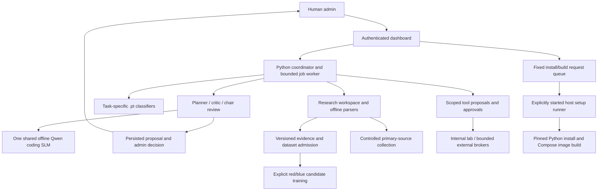

# AZRAEL-54 architecture

AZRAEL-54 is the product name. The current registry has 57 roles: the original
54 plus the red/blue PoC pair and the junior research role already present in the
working tree. Sixteen existing experimental classifier checkpoints are loaded;
six pass the application's narrow benchmark readiness gate. Registration, an
installed library and a successful generation do not qualify an autonomous model.



## Coordination and supervision

`admin.App` validates commands and runs one background command at a time. The
coordinator is Python orchestration, not a separately trained coordinator model.
`hierarchy.py` assigns reporting levels; a rank does not grant execution authority.

`lab.Bus` retains at most 1,000 structured events in memory. The dashboard receives
the latest 200. An event records sequence, UTC time, sender, receiver, kind and a
bounded payload. Peer messages contain request IDs and digests; generated review
text is retained separately in private council reports. These are local logical
nodes, not independent distributed model services.

`council.Council` runs three role contexts in order: planner, counterpart critic,
and chair. Each pass receives a bounded excerpt of prior output, plus the shared
SLM's evidence context. Reports retain full outputs, hashes, partial failures and
an admin decision. The chair revises the recommendation, but the workflow never
applies source edits or changes permissions. An admin objective or agreement among
role contexts is not independent verification.

## Research, libraries and data

`research.py` exposes retained tool documentation and repository metadata,
controlled live public feeds, and byte-input parsers for HTML, XML, certificates,
captures, DNS messages, instruction bytes, PE/ELF headers and YARA signatures.
The library registry records pins, primary documentation, intended roles and
measured installed versions. A missing optional native library fails explicitly.
The inspection UI accepts at most 15,000 supplied bytes; it reads no ambient host
files, interfaces or processes. Parsing is not model inference or proof of malware.

Public evidence retrieval uses the existing exact-source transport and bounded
collector. This is not unrestricted web crawling. `role_research.py` adds 57 authored
role profiles with three fixed API queries each (Stack Overflow, Security Stack
Exchange and GitHub repository metadata). Current red/blue reference exports hold
684 role-document assignments from 316 distinct source-document identities;
query routing is not a verified label and all exports remain ineligible for training.
The last live query attempt failed under this sandbox’s network restriction.

Five authored search-operator templates are available to 11 vulnerability/web
research roles only after an authenticated admin assigns an exact domain or
repository. They produce manual search links with no automatic request or link
following. Reference searches and fresh collection are distinct; freshness, hashes,
unknown licensing and admission state remain visible. The shared SLM receives
stored search excerpts as untrusted data, and receives scoped search templates only
for an eligible role with an enabled admin assignment.

## Red / blue candidates and learning

`poc_training.py` trains separate small classifiers for the recorded labels
`reproduced` and `mitigation_verified`. Inputs are six declared configuration
features, each from zero through one. This is lab-outcome classification, not an
attack executor, a patch generator or a general malware detector.

Training requires three distinct, valid frozen manifests with training-quality
admission, matching task `authorized_lab_outcomes_v1`, and extraction schema
`azrael_poc_six_features_v1`. Normalized records must contain `poc_features` and
`poc_labels`. The trainer rejects cross-split record, duplicate-cluster and exact
feature-vector overlap, as well as repeated observations within a split. Each
split needs both labels for both tasks. Independent observations that share a
campaign or environment still require human split/provenance review; these checks
do not prove absence of every form of leakage.

The best validation-loss weights are measured once against the supplied test
split and a training-majority baseline. Checkpoints remain isolated candidates.
No existing role weights are overwritten or promoted. Revoked evidence, invalidated
manifests or changed checkpoint hashes disable candidate use. This does not erase
learned weights or establish machine unlearning. No qualifying operational PoC
dataset was supplied during this build; training tests use explicitly labeled
temporary fixtures only.

## Visualization

The role view projects registered identities into 3D. Its fourth dimension is
recorded event time, selected with the slider. Role cards expose measured checkpoint
parameters, tensor counts and readiness. No neuron activity or live learning is
invented.

The inventory view uses only an explicitly supplied inventory. The spread/containment view can scrub a completed what-if simulation by step and highlights shared, red-only, contained and unreached nodes. Observed relationships
remain caller assertions; hypotheses use a different line style. The spread model
compares bounded directed reachability with and without listed contained nodes.
It assumes all supplied links are traversable and performs no exploitation,
replication, command-and-control or endpoint changes.

## Installation and deployment

From the project folder:

```bash
bash install.sh --runtime auto --install --build --start --verify --verify-slm --verify-providers
```

`--runtime auto` selects functional rootless Podman first and Docker Compose second.
Use `--runtime podman` or `--runtime docker` to pin a runtime. Compose files resolve
from the installer location and this stack uses project name `azrael54`. The
dashboard is loopback-bound. `compose.podman.yaml` adds rootless `keep-id` mappings
for the existing bind-mounted data and per-user secrets. The SLM stays offline and
uses CPU fallback unless a future container GPU setup is separately verified.

The lifecycle commands are:

```bash
bash install.sh --runtime podman --status --verify --verify-slm --verify-providers
bash install.sh --runtime podman --restart
bash install.sh --runtime podman --stop
```

`--plan` prints commands without executing them. Start
`bash install.sh --runtime auto --serve` in a second terminal to accept fixed admin
install/build requests; Ctrl-C stops that host watcher.

The dashboard requires its existing session and mutation protections plus explicit
confirmation to queue the single `install_and_build` operation. Requests bind the
installer/dependency catalog digest, expire after five minutes and are consumed
once. The host runner accepts no caller-selected command, path or arguments. It
retains bounded logs and exit status. The dashboard receives no container socket
or host shell.

The queue is private project storage, not a signed or tamper-proof audit system.
The explicitly started host runner trusts the project source and the local user
who can write its queue. It must not be offered as an untrusted public service.

## Verification limits

See `BUILD-STATUS.md` and the validation JSON files. Host-side tests are distinct
from image builds, container isolation, browser verification and model quality.

## Live training coordinator

The authenticated live-readiness workflow is implemented in `training_coordinator.py` and uses the existing shared SLM scheduler. Each mission captures one read-only snapshot from the Operations API: service health probes on the AZRAEL private network, dashboard-container CPU/memory and persistent-storage measurements, visible model/GPU status, and evidence/dataset metadata. The snapshot receives a SHA-256 provenance identifier before role work begins. No synthetic telemetry is generated, no endpoint agent is installed, and no mission can execute model output or alter a service.

Red review, blue triage, threat context, DFIR, incident response, purple coverage and evaluation are serialized as dependent tasks. They are separate prompts to one local Qwen model; they are not independent models or verified findings. MITRE ATT&CK identifiers in a report are marked reference-only unless independent telemetry establishes an event. A completion score measures task coverage, not response accuracy. Historical replay returns the exact stored snapshot and outputs without re-running tasks.

Mission state, task dependencies, hashed outputs, timings, role metrics, audits, human decisions and dataset-version hashes are additive tables in the existing evidence SQLite database. A reviewer must accept a mission, record a confidence score and choose train/validation/test before that record can be exported. Exact source snapshots cannot cross data splits. No model is trained or promoted automatically. The coordinator's emergency stop cancels queued work and terminates the active local SLM child; AZRAEL containers remain running. Existing synthetic fixtures remain available only in their existing fixture/testing workflows.

## Training console API

- `GET /api/training` — authenticated coordinator status and recent missions.
- `GET /api/training/missions/{id}` — authenticated mission playback, provenance, timeline and audit.
- `POST /api/training/missions` — starts a live review only with `{"approved":true}` and optional priority.
- `POST /api/training/missions/{id}/cancel` — cancels one queued or active review.
- `POST /api/training/emergency-stop` — cancels queued missions and active SLM work.
- `POST /api/training/reset` — explicitly resets the emergency stop with `{"confirmed":true}`.
- `POST /api/training/missions/{id}/review` — records accept/reject, reviewer confidence, note and dataset split.
- `GET /api/training/missions/{id}/export` — exports accepted human-reviewed records only.

All mutation routes require the existing admin session, same-origin checks and `X-Lab-Request: 1`. These APIs expose no host shell, Podman socket, arbitrary command, or endpoint-control operation.
