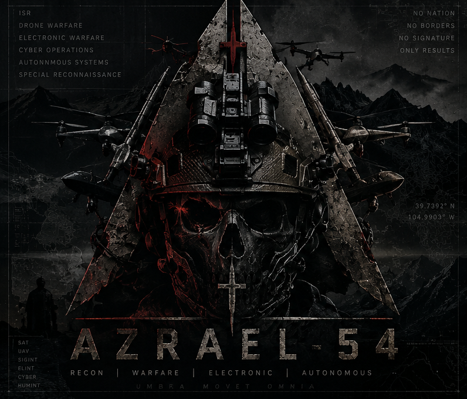
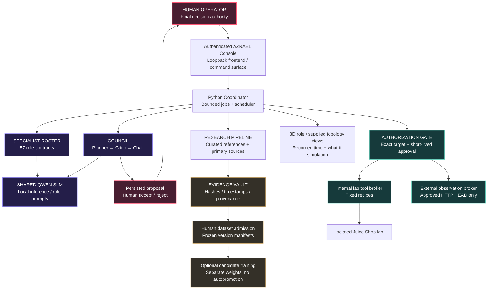
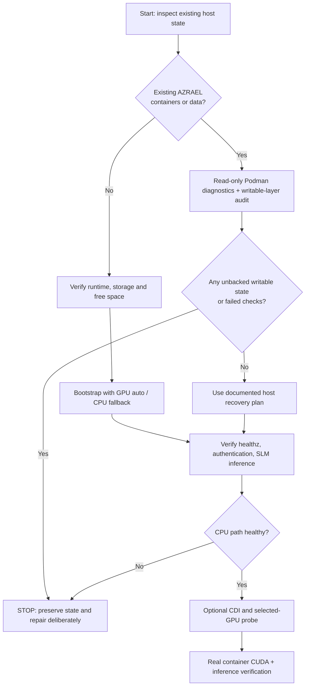
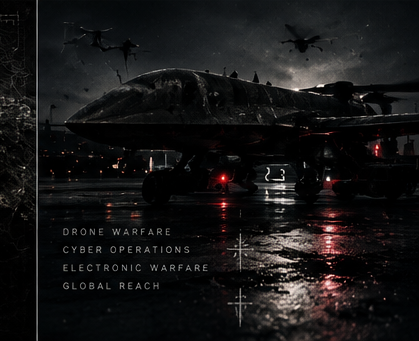
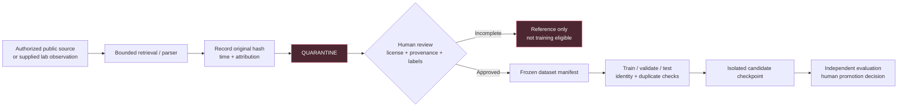

[README(1).md](https://github.com/user-attachments/files/33755075/README.1.md)
<!--
  AZRAEL-54 // GITHUB PROJECT DOSSIER
  Designed for GitHub's standard Markdown renderer.
  All product statements distinguish source implementation, local tests,
  historical verification, and unverified host/runtime capability.
  The included images are relative links to the existing repository artwork.
-->

<div align="center">


# A Z R A E L — 5 4

### THE SIGNAL IS NOISE. THE EVIDENCE IS EVERYTHING.

**A human-commanded, AI-assisted cybersecurity research and adversary-emulation workspace.**  
**57 specialist role profiles · one local coding SLM · bounded lab tools · evidence-first operations**


<br>
<br>



`[ RESEARCH ]` · `[ DEFENSE ]` · `[ ADVERSARY ANALYSIS ]` · `[ FORENSICS ]` · `[ AI ]` · `[ HUMAN OVERSIGHT ]`

**[System overview](#system-overview) · [Architecture](#system-architecture) · [Quick start](#quick-start) · [Mission modules](#mission-modules) · [Roadmap](#development-roadmap) · [Security](#rules-of-engagement--security)**

</div>

---

> [!IMPORTANT]
> **AZRAEL-54 is an experimental, locally operated research system, not a production-ready autonomous attack platform.** The 57 roles are *configured specialist identities*, not 57 separately trained LLMs. Existing task-specific checkpoints have limited evaluations, and model output is not verified evidence. Current host operation must be rechecked before calling any service or GPU path healthy. See [BUILD-STATUS.md](BUILD-STATUS.md) and [KNOWN-ISSUES.md](KNOWN-ISSUES.md).

## SYSTEM OVERVIEW

```text
╔══════════════════════════════════════════════════════════════════════╗
║                      A Z R A E L  //  5 4                        ║
║                                                                      ║
║  OPERATOR   : HUMAN / FINAL AUTHORITY                                ║
║  INTERFACE  : AUTHENTICATED LOCAL COMMAND CONSOLE                    ║
║  REASONING  : SHARED OFFLINE QWEN CODING MODEL                       ║
║  ROSTER     : 57 SPECIALIST ROLE CONTRACTS                           ║
║  EVIDENCE   : HASHED / ATTRIBUTED / REVIEWED / VERSIONED             ║
║  ACTIONS    : FIXED RECIPES / EXPLICIT SINGLE-USE APPROVALS          ║
║  DEFAULT    : LOOPBACK / CPU-SAFE / NO AUTOMATIC EXECUTION           ║
║                                                                      ║
║           OBSERVE  →  CORRELATE  →  REVIEW  →  AUTHORIZE              ║
╚══════════════════════════════════════════════════════════════════════╝
```

AZRAEL-54 brings together a tactical web console, a shared local language model, specialist research personas, reference retrieval, evidence management, offline analysis, role-to-role review, controlled lab execution, and optional model-training workflows. It is designed around one rule:

**A model can recommend. A source can inform. Only the operator can authorize.**

The project separates *what is registered*, *what exists in source*, *what passed a test*, and *what is actually running*. A flashy dashboard is not a substitute for measurable behavior.

<div align="center">
<table>
<tr>
<td align="center"><b>57</b><br><sub>Registered role profiles</sub></td>
<td align="center"><b>16</b><br><sub>Experimental classifier checkpoints</sub></td>
<td align="center"><b>6</b><br><sub>Checkpoints meeting narrow readiness gates</sub></td>
<td align="center"><b>1</b><br><sub>Shared local coding SLM</sub></td>
</tr>
<tr>
<td align="center"><b>6</b><br><sub>Defined Compose services</sub></td>
<td align="center"><b>4</b><br><sub>Fixed internal lab recipes</sub></td>
<td align="center"><b>21</b><br><sub>Project artwork files validated in recovery</sub></td>
<td align="center"><b>0</b><br><sub>Verified autonomous exploit executors</sub></td>
</tr>
</table>
</div>

<sub>Counts are taken from the supplied October 2026 source and recovery documentation; they are not live metrics. Six classifier readiness passes are narrow-task gates, not broad operational qualifications. Artwork publication rights require separate review.</sub>

## SYSTEM ARCHITECTURE



### The six service boundaries

| Service | Function | Exposure |
|:--|:--|:--|
| `frontend` | Nginx-based web entrypoint | Published to `127.0.0.1:8765` by default |
| `dashboard` | Authenticated API, coordinator, model integrations | Private project network |
| `tools` | Controlled internal security-tool broker | Private project network |
| `imports` | Allowlisted source collection and imports | Dedicated public-imports egress |
| `external-tools` | Separate bounded external observation broker | Dedicated public-observations egress |
| `web-lab` | Intentionally vulnerable OWASP Juice Shop target | Internal lab only; no published host port |

Container configuration uses rootless-friendly identities, dropped Linux capabilities, read-only filesystems, resource limits, and distinct networks. These controls reduce risk; **they are not proof of complete isolation**.

## QUICK START

**Target environment:** Linux, especially Pop!_OS, with rootless Podman and its Compose provider. Python tooling and optional NVIDIA CUDA require matching host dependencies. Docker Compose support exists as a secondary path; results may differ by runtime.

For a **fresh, isolated setup** with the source already checked out:

```bash
cd azrael54
chmod +x azraelctl
./azraelctl bootstrap --gpu auto
```

`--gpu auto` attempts a constrained, real container GPU readiness check and should fall back to CPU when CUDA passthrough is not usable. To *require* GPU validation instead of permitting fallback:

```bash
./azraelctl bootstrap --gpu on
```

The intended local interface is **http://127.0.0.1:8765**. Its sign-in token is generated or reused locally and **must never be posted to GitHub or included in screenshots**.

> [!CAUTION]
> **Do not use quick start to replace or recreate an existing AZRAEL deployment blindly.** The backup documents a host with unresolved healthcheck, rootless Podman, container-state and/or CDI issues at different points during October 20 recovery. Preserve SQLite data, inspect writable layers, and follow [RESUME-ON-HOST.md](RESUME-ON-HOST.md) before any host recovery or recreation. A successful source test is not a successful host deployment.

### Command deck

```bash
./azraelctl doctor        # Host/runtime diagnostics
./azraelctl status        # Project operational summary
./azraelctl verify        # Project verification stages
./azraelctl logs          # Service log collection
./azraelctl start         # Start approved existing project stack
./azraelctl restart       # Controlled lifecycle request
./azraelctl stop          # Stop AZRAEL project services
./azraelctl update        # Explicit project update workflow
./azraelctl --help        # CLI options and implementation help
```

**Do not equate a command's presence with a verified working host path.** Run `doctor`, inspect the result, and keep copies of your persistent data before any destructive step.

<details>
<summary><b>Show the deployment decision tree</b></summary>



**Relevant guides:** [PODMAN-SETUP.md](PODMAN-SETUP.md) · [STORAGE-SETUP.md](STORAGE-SETUP.md) · [RESUME-ON-HOST.md](RESUME-ON-HOST.md) · [GPU deployment findings](docs/GPU_DEPLOYMENT_STATUS.md)

</details>

## MISSION MODULES

<table>
<tr><td width="50%">
<h3>01 // SPECIALIST HIVE</h3>
57 registered profiles coordinate through bounded messages, hierarchy metadata and a shared coding SLM. Role naming and rank do not create independent weights, additional privileges or autonomous workers.
</td><td width="50%">
<h3>02 // THE COUNCIL</h3>
Planner, critic and chair run successive prompts against the <i>same</i> local model. Proposed decisions are logged for human review; the council never silently patches source code.
</td></tr>
<tr><td>
<h3>03 // EVIDENCE VAULT</h3>
Source URLs, hashes, collection dates, licensing state, record revisions, duplicate groups and reviewer decisions remain distinct. References are quarantined before any training-quality admission.
</td><td>
<h3>04 // RESEARCH ARRAY</h3>
Curated Kali, Parrot and BlackArch references, public vulnerability intelligence, fixed source collectors, repository metadata and supplied-file parsers support investigation without unrestricted browsing.
</td></tr>
<tr><td>
<h3>05 // CONTROLLED LAB</h3>
Four fixed internal recipes use curl, Nmap, WhatWeb and Nikto against the owned Juice Shop lab. A separate approval path permits one limited HTTP HEAD observation of an authorized public URL.
</td><td>
<h3>06 // TRAINING COMMAND</h3>
A serialized red/blue/threat-intel/DFIR/response/purple/evaluation review pipeline records mission snapshots, outputs and timings. Human review and an explicit dataset split are required before export.
</td></tr>
<tr><td>
<h3>07 // TACTICAL VISUALIZATION</h3>
Interactive 3D role communication, recorded-time playback, supplied-inventory topology and spread-versus-containment <i>what-if</i> graph analysis. No invented live endpoint telemetry.
</td><td>
<h3>08 // GPU OPERATIONS</h3>
Optional NVIDIA CUDA selection and container-device checks. CPU fallback remains the default-safe path; containerized CUDA and model inference must be measured again after runtime changes.
</td></tr>
</table>

### The shared intelligence layer

| Layer | Implemented contract | Boundary |
|:--|:--|:--|
| **Language model** | `Qwen/Qwen2.5-Coder-1.5B-Instruct` | Single local, offline inference worker; not 57 LLMs |
| **Context routing** | Role-specific prompts, tool suggestions, council reviews | Generated text never directly executes |
| **Classifiers** | 16 experimental `.pt` checkpoints | Only six meet narrow readiness checks; limited task coverage |
| **Learning candidates** | Separate red/blue lab-outcome classifier pipeline | Requires real, admitted and split-safe labels; no general operational dataset established |
| **Telemetry** | Real recorded local snapshots and service checks | No fictitious signals, endpoint implants, or continuous hardware discovery |
| **Model promotion** | Isolated candidate output and review interfaces | No automatic weights promotion or recursive self-improvement |

For precise boundaries, see [SLM.md](SLM.md), [ROSTER.md](ROSTER.md), [ARCHITECTURE.md](ARCHITECTURE.md) and the reports in `models-*/`.

## VISUAL COMMAND CENTER

<div align="center">
<table>
<tr>
<td align="center" width="50%"><br><sub>RECON // SIGNAL INTELLIGENCE</sub></td>
<td align="center" width="50%"><br><sub>TOPOLOGY // EVIDENCE PATHS</sub></td>
</tr>
<tr>
<td align="center"><br><sub>SPECTRUM // RESEARCH PLANNING</sub></td>
<td align="center"><br><sub>OBSERVATION // CONTROLLED OPERATIONS</sub></td>
</tr>
</table>
</div>

The supplied dashboard source contains theme selection, role cards, a 3D canvas with recorded-time controls, a message timeline, a readiness panel, a research console, a human approval queue, mission history, topology and review tools. Artwork is decorative; operational panels must use real, appropriately labeled data.

**Image provenance note:** these are repository-relative references to existing AZRAEL artwork. Confirm redistribution rights and attribution before making the repository public. A hash match does not confer a license.

## EVIDENCE → INTELLIGENCE → CANDIDATE TRAINING



The red/blue candidate contract uses six declared configuration features and two outcome tasks: **reproduced** and **mitigation_verified**. Its workflow includes split-integrity checks and baseline comparisons. The project docs do **not** establish a completed operational candidate training run on admitted real-world labels. A candidate score cannot prove the presence of a vulnerability.

### Boundaries that matter

- **Collection ≠ training.** Fetching CISA KEV or source metadata is not weight updating.
- **Role profile ≠ trained specialist.** A prompt context does not create a new independent model.
- **Council agreement ≠ validation.** Multiple prompts to one SLM can share errors.
- **Reachability ≠ compromise.** A topology simulation does not conduct exploitation.
- **GPU visibility ≠ deployed GPU inference.** The specific service must execute and pass an observed inference test.
- **Source hash ≠ truth.** Integrity and provenance do not independently verify a technical finding.

## NVIDIA / CUDA OPERATIONS

AZRAEL includes a selected-device CUDA path for compatible NVIDIA hardware. The archived environment identifies these cards:

| GPU | Historical host/probe coverage | Current service requirement |
|:--|:--|:--|
| GeForce RTX 3080 | Earlier local CUDA operations recorded | Re-verify CDI, container CUDA, PyTorch, and authenticated model inference |
| GeForce RTX 3060 Ti | Earlier local CUDA operations recorded | Re-verify selected-device passthrough and CUDA allocation |
| GeForce RTX 5060 | Earlier local CUDA operations recorded | Re-verify driver/toolkit compatibility and actual container execution |

Historical test artifacts record CUDA activity, but subsequent host/network/container problems invalidate assumptions of **current** end-to-end availability. A three-GPU probe is not proof of distributed Qwen training or model sharding. See [the GPU evidence ledger](docs/GPU_DEPLOYMENT_STATUS.md).

## RULES OF ENGAGEMENT & SECURITY

> [!WARNING]
> **Operate only on assets you own or are expressly authorized to test.** The internal `web-lab` is intentionally vulnerable. Keep it private and never publish it directly onto an untrusted network. Model-generated suggestions have no authority to change this boundary.

| Safeguard | Operating principle |
|:--|:--|
| **Local first** | Frontend bound to host loopback by default |
| **Human sign-off** | Fixed tool actions require exact, explicit approval |
| **Ephemeral authorization** | Single-use approvals expire after five minutes |
| **Tool containment** | Fixed arguments, target controls, process/output limits |
| **External scope** | One approved HTTP HEAD request; pinned public resolution; no redirect following |
| **Session boundary** | Local token-backed login, protected mutations and session cookies |
| **Separation of duties** | Private brokers, data collectors and lab networks |
| **Inference isolation** | Retrieved web text does not become a system instruction |
| **Conservative evidence** | Hash, record origin, review status and limitations preserved |
| **No silent escalation** | Role labels, directives and council outputs grant no execution rights |

### Before publishing to GitHub

**The uploaded backup contains local `.runtime/` secret-token files.** They are excluded by the present `.gitignore`, but that does not prove secrets were never committed or included in a previous Git revision. Rotate exposed tokens and audit the repository **and its history** before publishing. Do not push the backup archive itself.

```bash
# Review repository state without printing credential contents.
git status --short --ignored

# Check whether sensitive paths are tracked.
git ls-files | grep -E '(^|/)(\.runtime|\.env|\.slm-model|\.slm-venv|data)/|(^|/)(admin-token|broker-token|external-token)$' || true

# Review the commit history and run an appropriate local secret scanner
# before changing repository visibility or pushing to an external remote.
```

Exclude private credentials, real target details, personal data, unreviewed evidence, licensed datasets, large model weights and unneeded local Python environments. Git history must be examined separately if anything sensitive was previously tracked. For detailed boundaries read [SECURITY.md](SECURITY.md) and [API_KEYS.md](API_KEYS.md).

## CURRENT VERIFICATION LEDGER

**Archive snapshot:** October 21, 2026. These are documentation/source observations, not a live host inspection.

| Subsystem | Evidence in archive | Status |
|:--|:--|:--|
| Source and Compose configuration | Python/shell/YAML checks documented | **Locally tested** |
| Test suite | `102` tests run; `2` skipped in one documented local suite | **Historical local pass** |
| Role / model inventory | 57 profiles; 16 experimental checkpoints | **Source inventory** |
| Shared SLM | Local host inference previously documented | **Container state needs recheck** |
| Rootless Podman stack | Healthcheck/state/network issues reported across recovery | **Host recovery / verification pending** |
| GPU runtime | Host CUDA historically exercised on three GPUs | **Current service inference needs recheck** |
| Browser UI | Dashboard source and artwork present | **Interactive QA not fully verified** |
| Red/blue candidate training | Contract and fixture-driven tests exist | **No qualifying real-data training established** |
| General autonomous red teaming | No general executor supplied | **Not implemented** |

> [!NOTE]
> The archive includes status documents from different stages of the same recovery. An earlier successful verification does not override a later failure. Consult the most recent actual host outputs rather than treating this README as a live health monitor.

## DEVELOPMENT ROADMAP

The following is **planned work**, not a promise that the features already run. The highest priority is a verifiable, repeatable recovery before expanding capabilities.

- [x] Tactical AZRAEL identity and repository artwork integration in source
- [x] Authenticated console, role registry, shared-SLM orchestration and evidence APIs in source
- [x] Scoped tool broker, fixed internal recipes and approval structures in source
- [x] Source-level test suites and recovery/verification documentation
- [ ] **PHASE 01 — Host recovery:** Repair rootless container state, healthcheck ordering and frontend-to-dashboard connectivity without losing preserved data
- [ ] **PHASE 02 — Verified deployment:** Pass `/healthz`, authenticated API, project health, restart persistence and actual SLM inference
- [ ] **PHASE 03 — CUDA commissioning:** Verify CDI, each selected GPU, real container inference, reproducible GPU telemetry and CPU rollback
- [ ] **PHASE 04 — Research quality:** Expand validated primary sources, provenance/licensing review and adversarial evidence-quality tests
- [ ] **PHASE 05 — Model qualification:** Obtain real, authorized, labeled datasets; frozen leakage-resistant splits; honest held-out measurements
- [ ] **PHASE 06 — Mission console QA:** Confirm browser interactions, 3D accessibility, topology provenance and cancellation/replay behavior
- [ ] **PHASE 07 — Operational security:** Secret rotation/audit, supply-chain pinning, storage backup drills and improved deployment diagnostics
- [ ] **PHASE 08 — Controlled release:** Clean install reproducibility, contribution policy, artwork rights review and explicit licensing decision

**North star:** *More observable capability, fewer unverifiable claims.*

## REPOSITORY MAP

```text
azrael54/
├── azraelctl                 # Main operator CLI / lifecycle workflows
├── setup_lab.py              # Installer / preflight / host setup logic
├── compose.yaml              # Six service definitions
├── compose.podman.yaml       # Rootless Podman overlays
├── compose.gpu.yaml          # Optional selected GPU configuration
├── compose.docker-gpu.yaml   # Docker CUDA overlay
├── admin.py / ops_api.py     # Command API / operations surface
├── council.py / hierarchy.py # Sequential review contexts / reporting
├── model.py / slm.py         # Classifiers and shared local SLM
├── research.py / collection.py / live_data.py
│                            # Research, public sources and collection
├── evidence_store.py         # Persisted evidence / provenance
├── training_coordinator.py   # Authenticated mission coordination
├── tool_broker.py            # Fixed internal lab recipes
├── external_broker.py        # Bounded authorized observations
├── poc_training.py           # Optional isolated red/blue candidates
├── web/                      # Tactical UI, scripts and original artwork
│   └── art/
├── container/                # Container builds, Nginx and healthchecks
├── models-*/                 # Narrow-task experimental checkpoints
├── docs/                     # Requirements, research and GPU evidence
├── recovery/                 # Historical reconstruction and verification
├── SECURITY.md
├── ARCHITECTURE.md
└── BUILD-STATUS.md
```

<details>
<summary><b>Open the technical documentation index</b></summary>

| Document | Purpose |
|:--|:--|
| [ARCHITECTURE.md](ARCHITECTURE.md) | Actual orchestration, research and authorization model |
| [BUILD-STATUS.md](BUILD-STATUS.md) | Host deployment issues and local checks |
| [KNOWN-ISSUES.md](KNOWN-ISSUES.md) | Current blockers and hypotheses |
| [PODMAN-SETUP.md](PODMAN-SETUP.md) | Runtime-specific configuration and deployment |
| [STORAGE-SETUP.md](STORAGE-SETUP.md) | Persistence, capacity and isolation |
| [SLM.md](SLM.md) | Qwen worker, token bounds and model limitations |
| [SECURITY.md](SECURITY.md) | Local security and authorization controls |
| [TEST-RESULTS.md](TEST-RESULTS.md) | Observed tests versus unverified runtime behaviors |
| [RESUME-ON-HOST.md](RESUME-ON-HOST.md) | Conservative host recovery sequence |
| [docs/LIVE_TRAINING.md](docs/LIVE_TRAINING.md) | Mission snapshots, review and evidence lifecycle |
| [docs/CTF-AND-IDLE-TRAINING.md](docs/CTF-AND-IDLE-TRAINING.md) | Offline training/practice constraints |
| [docs/GPU_DEPLOYMENT_STATUS.md](docs/GPU_DEPLOYMENT_STATUS.md) | Historical CUDA and current runtime recovery evidence |
| [docs/FEATURE_REQUIREMENTS.md](docs/FEATURE_REQUIREMENTS.md) | Source implementation versus acceptance gaps |
| [docs/GAPS.md](docs/GAPS.md) | Outstanding recovery conflicts and missing artifacts |

</details>

## VALIDATION FOR CONTRIBUTORS

From an environment where the project's local Python dependencies are installed:

```bash
python -m unittest discover -p 'test_*.py'
node --check web/app.js
bash -n run.sh install.sh deploy-host.sh
```

These commands check selected source behavior and syntax. They do not certify OCI images, the host GPU stack, lab containment, the quality of generated security analysis, or a production deployment. In a constrained sandbox, socket-dependent tests may skip.

## CONTRIBUTION & DISCLOSURE

AZRAEL-54 is an experimental security research repository. Responsible contributions prioritize reproducible tests, explicit scope, observable evidence, narrow permissions, and a clear distinction between simulation and real effects. **Do not submit live credentials, private target data, exploit runs against third parties or malicious samples into public pull requests.**

For sensitive security findings, contact the repository maintainer privately rather than opening a public issue with exploit details or tokens. A formal vulnerability-disclosure contact has not been specified in this backup.

### License and artwork

No root `LICENSE` file was identified in the supplied archive. **Do not assume this repository is open-source licensed or that its model checkpoints, data sources and artwork are freely redistributable.** Add a suitable license and verify third-party and original-art rights before public release.

---

<div align="center">


### AZRAEL—54

**OBSERVE THE SIGNAL. VERIFY EVERYTHING.**

`LOCAL AUTHORITY` / `DEFENSIBLE EVIDENCE` / `HUMAN CONTROL`

*Built for research. Designed for restraint. Measured before claimed.*

</div>
