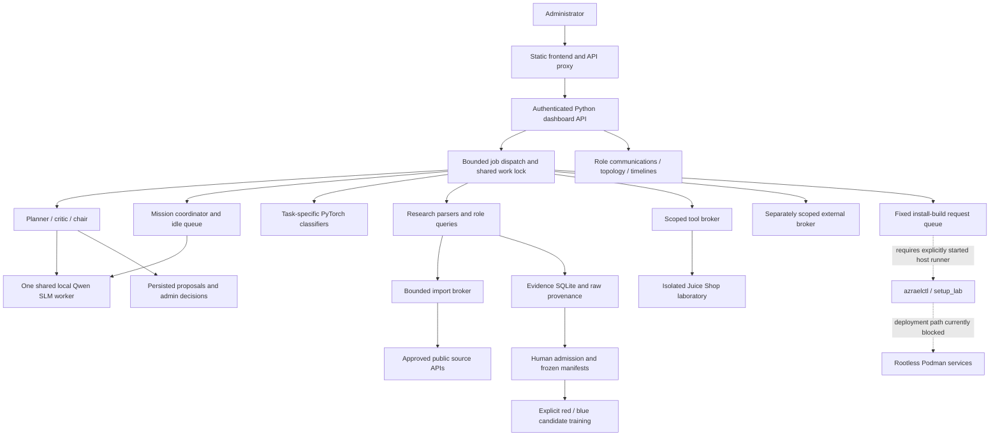

# AZRAEL architecture and rebuild boundaries

This is the architecture supported by recovered source and tests, with limitations
made explicit. It supplements the preserved ARCHITECTURE.md rather than replacing
historical content. Nothing here starts services or certifies the existing deployment.

## Persistent project location

The rebuilt working tree and Git repository live at:

```bash
export AZRAEL_HOME="$HOME/azrael54"
cd "$AZRAEL_HOME"
```

These commands select the source tree only. They do not launch AZRAEL. Recovery
scratch files and verification caches stay under `$AZRAEL_HOME/recovery`.
The user-selected external persistent store `/data/work/azrael54` is a distinct
historical data location; this recovery neither writes there nor changes its mounts.
Container-internal scratch mounts in recovered Compose are not project storage.

## System structure



Dashed deployment edges describe source interfaces, not permission to execute
them. The existing dashboard/network state remains unresolved.

## Service and process responsibilities

| Component | Source | Responsibility and boundary |
|---|---|---|
| Frontend | container/Dockerfile.frontend, container/nginx.conf, web/ | Static UI, assets and proxying to dashboard; no model inference or container socket. |
| Dashboard | admin.py, container/Dockerfile.app | Login/session controls, request validation, bounded job results, admin decisions and API routes. |
| Tools | tool_broker.py, container/Dockerfile.tools | Fixed/scoped internal laboratory tool requests with resource and permission checks. |
| Imports | import_broker.py, source_transport.py, source_fetch_worker.py | Bounded public-reference retrieval through explicit source policy; documents remain untrusted evidence. |
| External tools | external_broker.py, external_targets.py, external_runtime.py | Separate target/operation policy and approval surfaces; a registered role does not authorize arbitrary testing. |
| Web lab | Compose web-lab service | Juice Shop training target with state requiring preservation; it is not an unrestricted Internet target. |
| Shared SLM worker | slm.py, slm_worker.py | Serialized local inference using role/mode contexts; generated code is text, not an instruction to execute it. |
| Host setup runner | installation.py, setup_lab.py, azraelctl | Installer/build queue and lifecycle tooling; unavailable for execution during this recovery and subject to source conflicts. |

The later Compose design declares six services. Earlier requests mentioning five
refer to the stack before the frontend was added. Actual container state has not
been changed or revalidated by this documentation task.

## Models, roles and communication

- The later registry describes **57 logical role profiles**; the historical product
  name remains AZRAEL-54. These are not 57 independently trained autonomous models.
- **Seventeen .pt checkpoint files** survived in the image's models-* directories.
  Their presence is verified as files; loading, scores, dataset provenance and
  readiness have not been requalified. Older documentation's sixteen-model figure
  is historical and must not be silently presented as a fresh measurement.
- The shared SLM manifest specifies `Qwen/Qwen2.5-Coder-1.5B-Instruct`, revision
  `2e1fd397ee46e1388853d2af2c993145b0f1098a`. Its weights/tokenizer/config are absent.
- lab.Bus carries bounded local structured events; hierarchy.py adds reporting
  structure. Logical sender/receiver identities are not separate machines.
- Council uses sequential planner, critic and chair contexts. Outputs, hashes,
  partial failures and the operator's decision are retained. It proposes changes;
  it does not patch source, grant permissions or train weights.
- The mission coordinator adds dependent role tasks, priorities, snapshots,
  review/export gates and cancellation. A completion score measures task coverage,
  not correctness of generated conclusions.

## Evidence and learning pipeline

```mermaid
flowchart LR
    Sources[Explicit source / authorized observation] --> Collect[Bounded collection]
    Collect --> Stage[Quarantine and normalized provenance]
    Stage --> Human[Human quality / rights / labels review]
    Human --> Freeze[Frozen train / validation / test manifests]
    Freeze --> Train[Explicit candidate training]
    Train --> Evaluate[Held-out evaluation and baseline comparison]
    Evaluate --> Decision[Separate promotion decision]
```



EvidenceStore separates source records, versions, retrieval history, review
decisions, duplicate clusters, frozen manifest membership and deletion markers.
Reference documents and model-generated labels do not automatically become
evaluation ground truth. Collection and inference do not update weights.

The PoC red/blue trainers use six bounded declared features and the outcome labels
`reproduced` and `mitigation_verified`. Valid, separately frozen admitted datasets
are required. These are outcome classifiers, not exploit executors or automatic
patch generators. No qualifying operational splits are recovered.

Idle training requires an explicitly confirmed job and approved datasets, waits
for shared work to become idle, and records its state. Recovered tests use fake
trainers; their success would not prove a genuine training run.

CTF practice is a separate offline catalog/answer/progress subsystem. Its missing
pinned source assets prevent normal initialization. CTF attempts must remain
separate from operational evidence and supervised evaluation datasets.

## Research and library boundary

research.py exposes supplied-byte parsers and reference tools. The eleven pinned
research libraries span HTTP, certificates, graphs, XML, packet structures, HTML,
DNS, disassembly, PE, ELF and YARA. A dependency pin is not proof of installation,
safe device access, current data collection, or a successful analysis.

role_research.py supplies authored queries for role-specific reference collection.
Live retrieval, stored search and source admission are distinct operations.
The recovered transport is bounded and policy-based; it is not an unrestricted
crawler. The SLM receives excerpts with untrusted-evidence framing.

## UI and visualization semantics

The complete reaffirmed feature checklist is in FEATURE_REQUIREMENTS.md. All 21
AZRAEL artwork files match their original files and registry hashes. The UI uses
role capabilities, hierarchy, recorded communications and administrator proposals.

The communications view has 3D role positions and recorded event time as its fourth
dimension. It is not a neuron or weight-update visualization. The topology view
uses declared or supplied relationships; the spread/containment view compares
graph reachability and step playback. It does not discover exploitable paths,
replicate malware, install agents or provide botnet control.

## Deployment and GPU boundary

Recovered Compose describes rootless user mappings, isolated networks, loopback
exposure, read-only roots, dropped capabilities, no-new-privileges, resource limits,
script health checks and persistent bind mounts. compose.yaml is CONFLICT; these
declarations are not evidence that the current containers have those exact settings.

GPU code includes device selection, CDI compatibility, CUDA build overrides,
memory policy, per-device probes and CPU fallback. Host visibility, a successful
probe, service inference, supervised training and multi-GPU scaling are separate
claims requiring separate measurements. None is freshly established here.

azraelctl and setup_lab.py are CONFLICT. The unit-generator patch for
`KillMode=process` / `TimeoutStopSec=360` cannot be applied cleanly to the recovered
ExecStop context. The installed unit is untouched; no unit template is installed.

## Necessary rebuilding and next decisions

1. Preserve the recovered source and review its source-attributed conflict patches.
2. Obtain original missing datasets, model files, CTF sources and historical stores
   where reconstruction cannot establish truth.
3. Approve specification reconstruction one file at a time; use a separate path
   where necessary to protect recovered files, mark RECONSTRUCTED-FROM-SPEC, and
   commit each approved implementation independently.
4. Reconcile Compose/history and prepare installation documentation only after
   the earlier recovery gate is explicitly cleared.
5. Keep code recovery separate from any future operational recovery. The present
   task starts no services and does not touch existing containers or network state.

The source tree is persisted in `$HOME/azrael54` and committed to Git. Git records
recovery work; it does not substitute for a separate backup or prove reboot startup.
